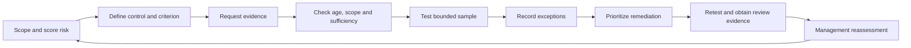

# GRC Evidence Lab

**A synthetic analyst work sample: from risk register to evidence gaps to management decisions.**

Harborlight Workspaces is fictional. Every organization, vendor, owner role, record and assessment result is synthetic. This repository is a portfolio demonstration, not employment history, client work, an audit opinion or a compliance certification.

## Start here — a three-minute recruiter review

1. Open [the executive summary](reports/executive-summary.md).
2. Download this repository and open [reports/index.html](reports/index.html) in a browser for the decision brief, linked control workpapers, risks, evidence and remediation queue.
3. Follow **R03 → C03 → E03 → T03 → M02**: CHG-003 lacks approval, its sample fails, and Engineering has a dated action with explicit closure evidence.

**Skills demonstrated:** risk scoring and rationale, evidence request tracking, freshness and scope review, sample testing, exception documentation, vendor assurance, remediation prioritization and executive communication. The Python automation supports the analyst's work; it does not replace an assessor's judgment.

## What the case shows

Six bounded controls, six risks, six evidence requests, six test workpapers, five open remediations and one critical supplier. One evidence file is deliberately absent. Historical audit and supplier reviews are deliberately stale. A change lacks approval. An incident exercise is proposed and untested. A three-event access removal sample passes only its stated criterion.

The case keeps current assessed risk at inherent level and displays proposed target scores separately. No controls receive automatic risk reduction from their implementation status or a passing fixture.

## Reproduce — Python 3.10 or newer, no dependencies

From the repository directory:

```text
python lab.py validate
python lab.py build
python -m unittest discover -s tests -v
python lab.py check
python verify.py
```

On Windows, `py -3` can replace `python` if needed. The build uses a fixed **2026-10-11** date and local fixtures. It needs no network, API keys, account, paid service or deployment. Open `reports/index.html` directly after building; no server is needed.

- `validate`: structural and relationship checks; exit 2 for invalid registers.
- `build`: regenerate HTML, assessment JSON, executive summary and CSV exports.
- `check`: compare committed assessment JSON and HTML with freshly computed content; exit 2 for drift.
- A valid dataset can still have failed or inconclusive control samples. Exit 0 means the artifact is structurally valid, **not** that controls are effective.

## Inspect the work

| Artifact | Purpose |
|---|---|
| [Registers JSON](data/registers.json) | Authoritative source; edit here, then rebuild |
| [Risk register](data/risks.csv) | Current scoring, proposed targets and rationales |
| [Control register](data/controls.csv) | Implementation assertions and NIST references |
| [Evidence register](data/evidence.csv) | Custodian, requested scope, period and freshness policy |
| [Test register](data/tests.csv) | Population, sample rationale, procedure and criterion |
| [Test results](reports/test-results.csv) | Computed result, findings and exceptions |
| [Remediation register](data/remediation.csv) | Owner, due date and closure criteria |
| [Vendor register](data/vendors.csv) | Critical supplier decision and trace |
| [Methodology](docs/methodology.md) | Scoring, status rules and closure gates |
| [NIST sources](docs/sources.md) | Partial mapping, version, rationale and remaining gaps |
| [Decision memo](docs/decision-memo.md) | Prioritization and tradeoffs |
| [Verification](docs/verification.md) | Actual checks executed for this version |

## Process



## Portfolio integration

[Notion-ready case study](docs/notion-case-study.md) is a concise companion for the GRC portfolio. Repository visibility starts private; external visitors need access until the owner approves public visibility. The report has no hosted public URL.

## Provenance and limitations

Fixtures were authored for this project with AI-assisted drafting and Python automation. They were never exported from a real organization. Role names describe fictional responsibilities and make no claims about the portfolio owner's employment. SHA-256 fingerprints identify fixture bytes, not evidence authenticity.

Mappings are illustrative and partial, informed by primary NIST sources verified October 11, 2026. This is not a complete baseline, regulatory compliance assessment, production security test, legal opinion, statistically representative audit or real vendor review. No real systems were probed. Passing automated tests confirms the demonstration detects its seeded gaps and reconciles outputs.
